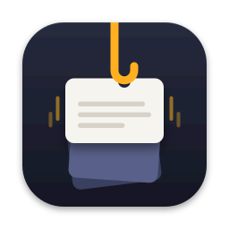

<p align="center">
  
</p>

<h1 align="center">Yank</h1>

<p align="center">
  <b>Everything you copy, one key press away.</b><br>
  A fast, private, keyboard-first clipboard manager for the Mac. Free and open source.
</p>

<p align="center">
  
  
  
  
</p>

Press <kbd>⇧</kbd><kbd>⌘</kbd><kbd>V</kbd> in any app. A row of cards slides up with everything you copied:
text, images, links, files and colours. Type to search, press Return to paste. The app you were working
in never loses focus.

## ✨ Why Yank

- ⌨️ **Keyboard first.** Open, search, pick and paste without touching the mouse. ⌘1–⌘9 paste by number,
  ⇧Return pastes as plain text.
- 🔎 **Search that finds it.** Results as you type, including words *inside* copied images and the
  titles of copied links.
- 🔒 **Private by design.** No account, no sync, no analytics. Your history is a file on your Mac.
  Copies that a password manager marks as private are never read.
- 📌 **Organised when you want it.** Pinboards for the things you paste every week, filters by type and
  date, and a paste stack for moving several things at once.
- 🪶 **Small and native.** A 7 MB menu-bar app written in Swift and SwiftUI. No Electron; the only helper
  is Sparkle's installer, which runs during an update.
- 🧑‍💻 **Open.** MIT licensed, about 7,000 lines of Swift plus tests, four small dependencies. Read it,
  build it, change it.

## 🛠 Under the hood

- **Sandboxed and hardened.** Yank runs in the App Sandbox with the hardened runtime and five
  entitlements. Release builds cannot be attached to by a debugger, because Yank's memory holds what
  you copied. One gap: library validation is off, because without an Apple team ID macOS would refuse
  to load Sparkle (see [Yank.entitlements](App/Resources/Yank.entitlements)).
- **Fast at scale.** History lives in SQLite with FTS5 full-text search. A test holds search to 33 ms
  (95th percentile) over 100,000 items, and the panel is built once and kept hidden so it opens instantly.
- **On-device intelligence.** Text in images is read with Apple's Vision framework. Nothing is uploaded.
- **Two network uses, both with a switch.** A copied web address is loaded once for its title and
  icon (local addresses never are), and Yank checks GitHub once a day for a new version.
- **Swift 6, strict concurrency.** The compiler checks for data races, warnings are errors, and a script
  keeps UI frameworks out of the core and the database behind one module.

## 📦 Install

You need a Mac with Apple silicon and macOS 26.4 or later.

1. Download `Yank-<version>.dmg` from the [latest release](https://github.com/ThatTechedGuy/Yank/releases/latest),
   open it and drag **Yank** onto the Applications folder next to it.
2. Open Yank. macOS blocks the first launch because Yank is not notarised by Apple (that needs a paid
   developer account). Open **System Settings › Privacy & Security**, scroll to the message about Yank
   and click **Open Anyway**. Or, in Terminal:

   ```sh
   xattr -dr com.apple.quarantine /Applications/Yank.app
   ```

3. Allow the two [permissions](#-permissions) when Yank asks.

Yank updates itself. On its second launch it asks whether to check for updates automatically (Settings ›
Privacy changes your answer), and the menu bar has **Check for Updates…**. Updates install without the
Open Anyway step, and keep the permissions you gave, because every release is signed with the same
certificate.

## 🎛 What it does

- **History panel.** A row of cards along the bottom of the screen, each with a preview.
- **Paste.** Return pastes the selected card, ⇧Return pastes it as plain text, ⌘1–⌘9 paste by number. You
  can also drag cards into other apps, or select several and paste them together.
- **Search.** Type to filter. Search also covers text inside images and link titles.
- **Pinboards and filters.** Keep items on named pinboards (⌘P), and narrow the row by type and date.
- **Actions.** ⌘K on a card: copy, rename, duplicate, share, open with, show in Finder, delete.
  Space opens a large preview.
- **Editor.** ⌘E edits a text card as rich text, or rotates an image and removes its background. ⌘N
  writes a new text item.
- **Paste stack.** Turn it on in the menu bar, copy several things, then press ⌃⌥⌘V to paste them one by
  one, oldest first.
- **Settings.** Open at login, where pastes go, the panel shortcut, ignored apps, how long history is
  kept, update checks, and Erase History.

## 🔐 Privacy

- A copy that its app marks as private (the `org.nspasteboard` marker types, which 1Password, the
  Bitwarden desktop app and KeePassXC set) is never read. A password manager that does not set the marker
  is saved like any other app: add it to Settings › Privacy › Ignored apps.
- Pause Saving in the menu bar stops saving for a while. Copies made during a pause are never saved.
- Yank goes on the network for two things. Link previews: it loads a copied web address once to get its
  title and icon. Updates: once a day it fetches the list of releases from GitHub, sending its version
  number. Settings › Privacy turns off either. Addresses written as local (`localhost`, `192.168.…`, `.local` and
  so on) are never loaded.
- Text in images is read on your Mac with Apple's Vision framework. Nothing is uploaded.
- By default the panel is hidden from screen recordings and shared screens.
- The history is not encrypted by Yank. It is as safe as your user account and your disk (turn on
  FileVault). It lives in `~/Library/Containers/com.thattechedguy.Yank/Data/Library/Application Support/Yank/`.
- Release builds log an error's code only, never its text, so copied content does not reach the system log.

Found a security problem? See [SECURITY.md](SECURITY.md).

## ✅ Permissions

macOS asks for two things, once each:

1. **Accessibility**, so Yank can press ⌘V for you. Without it Yank still puts the item on the clipboard
   and you press ⌘V yourself. Allow it from the welcome window, or in System Settings › Privacy & Security
   › Accessibility.
2. **Paste from Other Apps**, so Yank can read what you copy. On the first copy choose Allow, then set
   Yank to **Allow** in System Settings › Privacy & Security › Paste from Other Apps so it stops asking.

## 🧱 Build from source

You need Xcode 26 or later and [XcodeGen](https://github.com/yonaskolb/XcodeGen) (`brew install xcodegen`).
No Apple account is needed.

```sh
xcodegen                     # creates Yank.xcodeproj from project.yml (it is not committed)
open Yank.xcodeproj          # then press ⌘R in Xcode, or:
xcodebuild -scheme Yank -derivedDataPath build -destination 'platform=macOS,arch=arm64' build
open build/Build/Products/Debug/Yank.app
```

`scripts/release.sh` builds the Release configuration, checks it (signature, hardened runtime,
entitlements, no debug code) and copies `Yank.app` to `/Applications`. Quit a running Yank first.

**Signing.** Builds are ad hoc signed by default. macOS ties the Accessibility permission to the
signature, and an ad hoc signature changes with every build, so if you rebuild often, sign with your own
certificate: [Signing.xcconfig](Signing.xcconfig) says how. A free Apple ID is enough.

Debug and Release are two apps, "Yank Debug" and "Yank", with separate histories, settings and
permissions, so developing never touches your real history. Both claim ⇧⌘V, so quit one before running
the other.

`project.yml` is the source of truth for targets, build settings and dependencies. Change it, not the
Xcode project, then run `xcodegen` again. Adding or removing a Swift file also needs a rerun.

### Tests

```sh
scripts/test.sh --fast   # import check + package tests (minus the slow ones), a few seconds, no app launch
scripts/test.sh          # everything: slow package tests too, then the UI tests
```

The full run launches the Debug app and **writes to your clipboard**. It quits a running Release copy of
Yank first and reopens it afterwards, so test copies do not land in your real history. To keep your own
screen free, let GitHub run it instead: [tests.yml](.github/workflows/tests.yml) runs the full suite on a
GitHub Mac for every push to `main` and every pull request.

Package tests use Swift Testing. A test that seeds 100,000 items or loads a Vision model has a name
starting with `slow`, which is how `--fast` skips it. UI tests use XCTest, because only XCTest can drive
an app.

### Layout

| Path | What lives there |
| --- | --- |
| `App/` | The app target: windows, menu bar, panel, settings. `Features/Developer/` is a debug-only window. |
| `Packages/ClipCore/Sources/ClipCore` | Model, rules, storage, services and ports. No UI code; GRDB only in `Storage/`. |
| `Packages/ClipCore/Sources/ClipSystem` | Adapters that talk to macOS (clipboard, key presses, thumbnails, Vision). |
| `AppUITests/` | UI tests that drive the real app. |
| `scripts/` | `test.sh`, `check-imports.sh` (keeps the module rules above true), `release.sh`. |

Dependencies, all MIT: [GRDB](https://github.com/groue/GRDB.swift) (SQLite),
[KeyboardShortcuts](https://github.com/sindresorhus/KeyboardShortcuts) (the global shortcuts),
[Sauce](https://github.com/Clipy/Sauce) (finding the V key on any keyboard layout) and
[Sparkle](https://github.com/sparkle-project/Sparkle) (updates; it bundles a few parts under BSD-style
licences). Sparkle runs in Release builds only, so a debug run never offers to replace "Yank Debug".

## 🤝 Contributing

Issues and pull requests are welcome.

- Run `scripts/test.sh` before you open a pull request. Warnings are errors.
- Format with `swift format --in-place --recursive App AppUITests Packages/ClipCore` (4 spaces, 110
  columns, set in `.swift-format`); check with `swift format lint --strict --recursive` on the same paths.
- Comments say why, not what: a reason, a constraint, a platform quirk, a measured number. A known
  shortcut is marked `shortcut: <the limit>, <when to upgrade>`.
- Database access goes through GRDB's record API, not hand-written SQL. The few exceptions each have a
  comment saying why.
- Never edit a database migration that has shipped; add a new one.
- Log errors with `\(error.logDescription, privacy: .public)`, never the error itself: its text can hold
  what the user copied.
- **The lockfile** is `Packages/ClipCore/Package.resolved`. It pins all four dependencies, the app's
  too, because Xcode writes the app's pins there. Any edit to `Package.swift`, even a comment, changes
  its `originHash`: run `scripts/test.sh --fast` and commit the new hash. Avoid `swift package resolve`
  and `swift package update`; they drop the app's pin.
- The bundle ids (`com.thattechedguy.Yank`, `.debug`) appear in `project.yml`, the scripts, the log
  subsystem and the UI tests. A fork that changes them must change all of those.

Logs: open Console.app and filter on subsystem `com.thattechedguy.Yank`, or run
`log stream --predicate 'subsystem == "com.thattechedguy.Yank"' --info`.

**Cutting a release.** Raise `MARKETING_VERSION` and `CURRENT_PROJECT_VERSION` in `project.yml`
(Sparkle offers an update only when `CURRENT_PROJECT_VERSION` is higher than the installed one's), commit,
then push a tag for the version:

```sh
git tag v<version> && git push origin v<version>
```

[release.yml](.github/workflows/release.yml) builds and signs it with `scripts/release.sh --dmg` on a
GitHub Mac and attaches `Yank-<version>.dmg` and `appcast.xml` to a **draft** release. Installed copies
see nothing until you publish the draft. To release from your own Mac instead:

```sh
scripts/release.sh --dmg     # signed, checked, written to build/Yank-<version>.dmg and build/appcast.xml
gh release create v<version> build/Yank-<version>.dmg build/appcast.xml --generate-notes
```

Every installed copy reads the newest release's `appcast.xml`, so both files go on every release.

Releases need two keys in the maintainer's login keychain, made once and then backed up somewhere
safe, such as a password manager:

- **The "Yank Self-Signed" certificate**, which signs the app. Keychain Access › Certificate Assistant ›
  Create a Certificate, type Code Signing, with a long validity. A new one changes the signature, so
  every user gives the permissions again once. Back it up with Keychain Access › File › Export (.p12).
- **Sparkle's EdDSA key**, which signs each update: `generate_keys` from
  `build/release/SourcePackages/artifacts/sparkle/Sparkle/bin/` (after one `release.sh` run). Its public
  half is `SUPublicEDKey` in [App/Resources/Info.plist](App/Resources/Info.plist). Losing it means users
  can only update by downloading by hand. Back it up with `generate_keys -x <file>`.

The release workflow reads both from repository secrets, set once from the backups:

```sh
gh secret set YANK_CERT_P12_BASE64 < <(base64 -i Yank-Self-Signed.p12)
gh secret set YANK_CERT_P12_PASSWORD        # the .p12's password; gh asks for it
gh secret set SPARKLE_PRIVATE_KEY < sparkle-key.txt
```

## 🚧 Known limits

- Apple silicon only. macOS 26 is the last release that runs on Intel Macs.
- Not notarised, so the first launch needs the extra step under [Install](#-install). Updates do not.
- No sync and no iOS app.
- A file card stores the file's path, not the file. If the file is deleted, the card says so.
- A link preview checks the address as written. A public name that points to a local address is still
  loaded.
- The clipboard is read on the main thread, so a very large copy (hundreds of MB) can stall the app for
  a moment.

## 📄 Licence

MIT. See [LICENSE](LICENSE).
